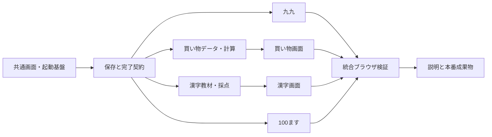

# 1. 目的と範囲

小学2〜3年生が、共通ホームから次の4つを遊べる静的Webアプリを構築する。

- 九九モンスター図鑑：9段の練習と9体の収集。
- お買いものクエスト：6クエスト以上。個数・金額のかけ算を含む。
- 漢字探検隊：通常40問以上と、追加モード「よみわけ探検」5〜10文。
- 100ます計算：3種類の計算、10問・25ます・100ます。

設計・実装・独立検証までを対象にし、公開・Git初期化・コミットは含めない。仕様の内容を変更する必要が生じた場合は、仕様変更を承認してもらう。

# 2. 仕様と確認済みの根拠

- [承認済み仕様](../specs/learning-game-suite.md)：`status: stable`、`human:user`による確認記録あり。
- 2026-10-09時点で、作業フォルダには仕様書のみ。既存コード・依存関係・テストはない。
- Gitは有効なリポジトリではない。現在はファイルシステムとネットワークの利用制限なし。
- 確認済みツール：Bun 1.3.14、Node.js v24.18.0、agent-browser 0.22.3。
- 学年別漢字配当表・算数の公的資料と、Vite公式資料は仕様書のsourcesを参照する。
- 漢字の文章は新規作成し、教材の転載はしない。学年ラベルは対象漢字の配当学年未満には設定しない（問題の対象学年は対象漢字の配当学年以上）。1年生の漢字も2年生向け問題の対象にできる。

# 3. 前提・制約・対象外

- ログイン不要、1ブラウザ1人分、localStorageによる端末内保存。
- 各ゲームの途中状態はメモリのみ。再読み込み・ゲームから離れる操作で選択画面へ戻り、未完了の記録や報酬を追加しない。
- UI・README・ユーザー向け文書は日本語。以下のTask Contractsはエージェント向けに英語で記載する。
- 外部画像・外部フォント・回答送信に依存しない。独自SVGと端末のフォントを使う。
- パッケージの正確なバージョンはT1でNode環境との互換性を確認して固定し、bun.lockを保存する。
- 音声・手書き判定・よみわけの書く問題・AI問題生成・ランキング・複数プロフィール・同期・公開は対象外。
- 既存の仕様書とこの計画の更新はオーケストレーターのみが行う。実装担当はこれらを編集しない。

# 4. Feature Contract

## 利用者と保証する結果

- 共通ホームから4アプリに移動でき、選択・回答・再挑戦・完了・結果確認・ホームへ戻る流れが成立する。
- 誤答や再挑戦があっても学習を終えられ、初回の正答数を正しく記録する。
- 報酬・完了記録は完了した回だけに付与し、操作の連打で二重登録しない。
- リロード後も完了済みの図鑑・スタンプ・宝物・自己ベストが残る。
- 保存不能・破損データでも遊べる。設定から確認を経てこのアプリの記録だけを消せる。
- 375px・768px・1280pxで主要操作ができる。100ます表以外は横スクロール不要。
- タッチとキーボードで操作でき、色以外で正誤が伝わる。動きを減らす設定を尊重する。
- 型検査・自動テスト・ブラウザ検証・本番ビルドを完了し、未実施や失敗した確認を明記する。

## 仕様との対応

| 仕様の範囲 | 主なTask | 最終確認 |
| --- | --- | --- |
| C1〜C4・C7、共通画面 | T1、各ゲームのUI | T9 |
| C5・C6・C8〜C10、保存 | T2、各ゲームの完了処理 | T9 |
| 九九9段・収集 | T3 | T9 |
| 買い物6件以上・かけ算2件以上 | T4・T5 | T9 |
| 通常の漢字40問以上 | T6・T7 | T9 |
| よみわけ5〜10文・2か所・5問 | T6・T7 | T9 |
| 100ます3演算・3サイズ・記録 | T8 | T9 |
| 起動・問題追加・保存の説明 | T10 | 最終評価 |

# 5. Execution Graph

P1の独立検証が完了してからP2へ進む。P2内で依存関係がなく、所有ファイルが別のTaskだけ並行可能。P3はP2の統合検証完了後に開始する。

# 6. フェーズ構成

| Phase | 目的 | Tasks | 成果物 |
| --- | --- | --- | --- |
| P1 | 共通基盤と保存契約を確立 | T1・T2 | 起動・ホーム・共通UI・保存API・基盤テスト |
| P2 | 4つの学習ゲームを完成 | T3〜T8 | 問題データ・採点・画面・各ゲームのテスト |
| P3 | 全体を実機相当で確認して引き渡す | T9・T10 | ブラウザ検証・日本語README・本番ビルド・検証記録 |

合計3フェーズ・10タスク。フェーズごとのコミットを伴わない`single`を推奨する。基盤APIと4アプリの結合を同じセッションで確認でき、Gitリポジトリのない環境でも進められる。

# 7. Phase Contracts

## P1：共通基盤

- 入力：承認済み仕様、この計画、空のアプリ領域。
- 依存：なし。
- 完成条件：4アプリの仮画面へ移動できる。保存の検証・完了の重複防止・記録削除・保存失敗への対応が自動テストで確認される。
- 次フェーズへの保証：`src/App.tsx`が各ゲームの`index.tsx`のデフォルトエクスポートを読み込む。各ゲームは`src/components/`のUIと`src/shared/progress/`の保存APIを使える。
- 保存APIのインターフェースとアプリ・モード・ステージ・報酬のID契約はこの計画の第8節に従い、T2が`src/shared/progress/README.md`（英語、エージェント向け）に型名・署名・ファイル名と対応表を残す。T2は回答・遷移のガードも提供する。
- 検証：`bun run typecheck`、`bun run test src/shared`、`bun run build`、ホームと設定のブラウザ確認。
- 消費者：P2の各実装担当、P1の独立検証担当。

## P2：ゲーム本体

- 入力：P1の検証済み基盤API、仕様に定めたゲーム内容と学習資料。
- 依存：P1 validated。
- 完成条件：4アプリとよみわけが仮画面を置き換え、完了・再挑戦・収集・保存まで動く。問題データと学年の確認記録がある。
- 次フェーズへの保証：`src/apps/{monsters,shopping,kanji,calculation}/index.tsx`からゲームを起動できる。純粋な問題生成・採点処理にテストがあり、教材は`src/apps/*/data/`、教材照合の記録は`docs/reviews/learning-content.md`にある。
- 検証：`bun run typecheck`、`bun run test`、`bun run build`、各ゲームの完了・再挑戦のブラウザ確認。各アプリの実際のIDを用いた完了記録が共通APIで検証され、対応する報酬だけを付与することを結合テストで確認する。通常漢字とよみわけの宝物が衝突しないことも含める。
- 消費者：T9・T10、P2の独立検証担当。

## P3：統合検証と引き渡し

- 入力：P2の検証済みゲーム、すべてのTaskとPhaseの検証結果。
- 依存：P2 validated。
- 完成条件：本計画第9節のブラウザシナリオと3画面幅の確認が成功し、日本語の起動・保存・問題追加の説明、本番ビルドが揃う。
- 成果物：`tests/e2e/`、`playwright.config.ts`、`README.md`、`docs/reviews/validation.md`、ローカルの`dist/`。
- 検証：`bun run typecheck`、`bun run test`、`bun run test:e2e`、`bun run build`、本番プレビューの起動確認。
- 消費者：最終評価担当、ユーザー。

# 8. 技術設計とTask Contracts

## 共通の技術設計

- React + TypeScript + Vite。アプリ内のURLはハッシュによるルーティングを使い、静的配信で直接開ける。
- ルート：`#/`、`#/monsters`、`#/shopping`、`#/kanji`、`#/calculation`、`#/settings`。未知のルートはホームへ戻す。
- ルートが変わるとゲームの途中状態を破棄する。ブラウザの戻る・進むでも完了した回を再度保存しない。
- 基盤のスタイル・共通部品はP1が所有する。P2はアプリごとのCSSと部品を所有し、基盤修正が必要ならオーケストレーターへ連絡する。
- 数字入力はキーボードと画面内ボタンに対応し、空欄と0を区別する。正常な入力は0以上の整数に限定する。
- 採点・問題生成・記録更新は画面から分けた純粋関数を中心にし、Vitestでテストする。
- E2EはPlaywright（Chromium）を使い、必要なブラウザをローカル環境に準備する。agent-browserによる目視確認を併用し、どの画面を確認したか記録する。
- 共通スクリプト：`dev`、`typecheck`、`test`（Vitest run）、`build`、`preview`、`test:e2e`。
- 回答・遷移は問題IDまたはステップIDと回答試行の識別子で保護する。1回の回答で採点・初回判定・次の問題への遷移をそれぞれ一度だけ行い、前の問題のイベントを次の問題へ適用しない。
- T2が`src/shared/interaction/`にガードとテストを用意する。イベント処理の先頭で同期的にロックし、連打・Enterのキーリピート・古いコールバックを無視する。誤答後は明示的な再挑戦で新しい試行を開始でき、初回の判定は上書きしない。T3・T5・T7・T8がこの契約を使う。

## 保存・完了APIの契約

- `src/shared/progress/types.ts`：`AppId`、`ModeId`、`CompletionRecord`、`Progress`などの型。
- `src/shared/progress/storage.ts`：アプリ専用キー1つ、バージョン1の読み書きとデータ検証。他のlocalStorageキーを削除しない。
- `src/shared/progress/reducer.ts`：完了記録の追加・収集・自己ベスト・直近50回の保持。
- `src/shared/progress/ProgressProvider.tsx`：`useProgress()`から`progress`、`storageStatus`、`completeSession(record)`、`resetProgress()`を提供する。
- `CompletionRecord`はセッションID、アプリ・モード、ステージまたは計算条件、問題数、初回正答数、完了日時、必要な場合の経過時間を持つ。報酬はアプリ・ステージから決定し、無関係な報酬を付与できない。
- ゲーム開始時に固定したセッションIDを完了まで使う。現在の記録に同じIDがあれば二重追加しない。画面側も完了処理を一度に制限する。
- 初回正答数の単位は、九九・通常漢字・よみわけでは問題、計算表ではマス。買い物は数値回答の設問（合計・おつり・実践問題）で、商品選択の修正回数は含めない。
- 自己ベスト更新は計時あり・計算表を全マス初回正解・完了した回だけで、演算とサイズ別に最短時間を保持する。
- 保存不能ならメモリの状態で遊びを継続する。破損または未知の保存バージョンは安全な初期状態へ退避し、短い案内を出す。未知のバージョンを自動上書きしない。
- リセットはアプリ専用キーと現在のメモリ記録を消す。保存禁止時にも、メモリ側のリセットは行う。

## IDと報酬の共通契約（T2が所有）

- `src/shared/progress/catalog.ts`とAPI READMEで、下記のID・対応表・完了記録の検証規則をT2が定義する。P2の教材・画面はこのカタログを参照し、別の規則でIDや報酬を作らない。
- 初版の買い物は6件、通常漢字は学年ごとに4ステージ、よみわけは5文の1ステージとする。仕様の最低件数を満たし、初版でカタログの後付け拡張を必要としない。

| AppId | ModeId | StageId / 条件 | 完了時の報酬・検証 |
| --- | --- | --- | --- |
| `monsters` | `kuku` | `monsters:dan-1`〜`monsters:dan-9` | 対応する`monster:dan-N`を1体。9問完了のみ |
| `shopping` | `standard` | `shopping:quest-01`〜`shopping:quest-04` | 対応する`stamp:quest-NN`。数値回答2問完了のみ |
| `shopping` | `multiplication-count` | `shopping:quest-05` | `stamp:quest-05`。個数の実践・合計・おつりの3問完了のみ |
| `shopping` | `multiplication-money` | `shopping:quest-06` | `stamp:quest-06`。金額の実践・合計・おつりの3問完了のみ |
| `kanji` | `standard` | `kanji:g2-01`〜`kanji:g2-04`、`kanji:g3-01`〜`kanji:g3-04` | 対応する`treasure:gN-NN`。5問完了のみ |
| `kanji` | `reading-difference` | `kanji:reading-difference-01` | `treasure:reading-difference-01`。5文完了のみ。通常宝物と別ID |
| `calculation` | `addition` / `subtraction` / `multiplication` | 演算とサイズ`10` / `25` / `100`の組み合わせ | 収集報酬なし。条件と問題数が一致した完了記録・適格な自己ベストのみ |

- T4・T6は上記のステージIDを用いた問題データを作る。各ゲームの完了生成担当T3・T5・T7・T8も同じModeId・StageIdと問題数に従う。
- 初版以降にID・件数を拡張する場合の所有者は共通カタログ担当とし、今回の担当が独自IDを増やさない。
- T2で不正なアプリ/モード/ステージの組み合わせ・問題数の不一致・初回正答数の範囲外を拒否し、報酬を付与しないことをテストする。P2の独立検証で実際の教材とカタログの一致を確認する。

## T1 — Project foundation and shared shell

- state: validated
- phase: P1; dependencies: none
- objective: Create the runnable client project, route shell, common interaction components, and accessible visual foundation.
- ownership: `package.json`, `bun.lock`, `.gitignore`, `index.html`, `tsconfig*.json`, `vite.config.ts`, `vitest.config.ts`, `src/main.tsx`, `src/App.tsx`, `src/components/**`, `src/styles/**`, `src/pages/**`; temporary default-export stubs in each `src/apps/*/index.tsx`.
- minimum context: stable specification C1–C4/C7/C8 and this Plan's routes; no existing code to preserve. Do not initialize Git or edit specification/Plan.
- expected artifacts: locked compatible dependencies, all required scripts except the E2E implementation, home/settings shell, responsive shared components, numeric-entry and feedback patterns, distinct app placeholders.
- acceptance: root and all hash routes load; unknown routes fall back; returning home unmounts the game; core buttons >=44px; focus visible; reduced-motion respected; placeholder screens have no permanent rewards.
- validation: `bun install`, `bun run typecheck`, `bun run build`; browser home/settings/navigation check at 375px and 1280px.
- preserve: approved user-facing scope; future tasks own their app directories after the stubs are handed over.

## T2 — Progress model, persistence, completion and settings

- state: validated
- phase: P1; dependencies: T1
- objective: Implement the shared identity/reward/completion/persistence and submission-guard contracts, and connect home summaries and confirmed reset.
- ownership: `src/shared/**`, `src/pages/Home.tsx`, `src/pages/Settings.tsx`, provider wiring in `src/main.tsx`.
- minimum context: C5/C6/C8–C10; Plan persistence API; T1 component/route contracts. Other work may coexist; do not revert it.
- expected artifacts: types, stable ID/reward catalog, validator, reducer, storage adapter, Provider/hook, submission/transition guard, meaningful pure-function tests, English API README with mode/stage/reward rules.
- acceptance: reload-safe collections/history/bests; history <=50; duplicate IDs do not duplicate results; invalid/corrupt/blocked/unknown-version storage remains playable; confirmed reset affects only this app; best times obey eligibility rules; invalid mode/stage/count combinations cannot award rewards; rapid repeated submit/stale callback cannot double-count or cross a question boundary; explicit wrong-answer retry remains possible.
- validation: `bun run test src/shared`, `bun run typecheck`, `bun run build`; browser reset/cancel, storage unavailable, and reload checks.
- preserve: T1 route/UI behavior and unrelated localStorage keys. No app-specific question/UI implementation here.

## T3 — Multiplication monster game

- state: validated
- phase: P2; dependencies: P1 validated
- objective: Deliver all nine multiplication stages, retry flow and collectible monster book.
- ownership: `src/apps/monsters/**` only.
- minimum context: specification section 1; P1 API README; completion contract. Other tasks may run; do not edit their files or the shared foundation.
- expected artifacts: stage/question engine, nine original SVG monsters with names, selection/play/result/book screens, domain tests.
- acceptance: each stage asks multiplier 1–9 exactly once in shuffled order; both numeric-entry methods work; retries preserve first-attempt score; only nine completed questions award that stage's catalog-defined monster; replay never duplicates collection; rapid clicks/repeated Enter advance at most once and cannot apply the previous answer to the next question.
- validation: `bun run test src/apps/monsters`, `bun run typecheck`; browser incorrect answer/hint/retry/completion/book/reload.
- preserve: common completion contract, keyboard/touch access, no forced timer or game-over.

## T4 — Shopping content and arithmetic engine

- state: validated
- phase: P2; dependencies: P1 validated
- objective: Define valid quests and pure basket, count, subtotal, total and change calculations.
- ownership: `src/apps/shopping/data/**`, `src/apps/shopping/domain/**` and their tests; no shopping UI files.
- minimum context: specification section 2; normal 3-step and multiplication 4-step quests; money <=1,000 yen; T2 catalog identifies four standard quests and two distinct multiplication quests.
- expected artifacts: >=8 products, six catalog-ID quests, one multiplication count quest and one multiplication money quest, typed engine and content validators/tests.
- acceptance: correct item IDs and quantities required; baskets editable; all totals/payments valid integers; no negative change; multiplication factors match the story; count questions cannot be confused with yen questions; early standard quests exercise two-digit addition/subtraction and later quests include three-digit arithmetic; every stage ID/mode/numeric-question count matches the T2 catalog; examples solvable within scope.
- validation: `bun run test src/apps/shopping/domain`, `bun run typecheck`; inspect all quest fixtures.
- preserve: no advance disclosure of final arithmetic answers; content wording original and suitable for children.

## T5 — Shopping interaction and quest stamps

- state: validated
- phase: P2; dependencies: T4
- objective: Present complete quest flows using T4 engine and shared completion API.
- ownership: `src/apps/shopping/index.tsx`, `src/apps/shopping/components/**`, `src/apps/shopping/styles.css` and UI helpers/tests outside T4-owned folders.
- minimum context: T4 schemas/fixtures; shopping spec; P1 UI/persistence contract. Do not revert other tasks' changes.
- expected artifacts: quest selection, editable basket, contextual multiplication/total/change steps, hints, result and saved stamps.
- acceptance: normal quests have 3 steps; multiplication quests have 4; incorrect basket cannot advance; incorrect numeric answers retain basket and can be retried; first score counts numeric questions; completed quests alone earn catalog-defined stamps; replay permitted; rapid submit/repeated Enter advances at most one step and never submits a previous answer to the next step or changes the first-attempt count twice.
- validation: `bun run typecheck`; browser one normal quest and both types of multiplication quests including wrong/retry paths.
- preserve: pure T4 domain logic; avoid showing total before the child answers it; all figures include appropriate units.

## T6 — Kanji content, multi-target grading and provenance

- state: validated
- phase: P2; dependencies: P1 validated
- objective: Produce and verify original normal/reading-difference questions and pure grading/stage engines.
- ownership: `src/apps/kanji/data/**`, `src/apps/kanji/domain/**` with tests, `docs/reviews/learning-content.md`.
- minimum context: specification section 3 including limited reading-difference mode; official MEXT kanji allocation table linked in specification.
- expected artifacts: >=20 normal questions per grade, four catalog-ID 5-question stages per grade, exactly five additional sentences and one catalog-ID 5-sentence reading-difference stage; all five sentences playable in each session with reorder permitted; content schemas/validators/tests; Japanese content-review record with direct source link and grade checks for every target character.
- acceptance: normal grade sets contain reading and usage; four distinct choices with exactly one contextual answer; unique stable IDs conforming to T2 stage/mode rules; question grade >= target allocation grade (same-grade characters allowed); each difference sentence has exactly two explicitly marked occurrences of the same character with distinct readings, per-target choices/hints; no duplicate questions in a stage; both targets must be correct; first score is sentence-based.
- validation: `bun run test src/apps/kanji/domain`, `bun run typecheck`; independent content audit of all sentences, answer uniqueness and target-grade mapping.
- preserve: normal >=40 question count excludes difference content; no writing/input mode; out-of-grade non-target text has furigana where needed; target answers never leak via furigana.
- external evidence: if more web verification is needed, request the orchestrator to delegate search to a researcher; never invent a grade mapping.

## T7 — Kanji adventure and reading-difference UI

- state: validated
- phase: P2; dependencies: T6
- objective: Integrate normal and reading-difference adventures with five-question sessions, retries and shared treasure book.
- ownership: `src/apps/kanji/index.tsx`, `src/apps/kanji/components/**`, `src/apps/kanji/styles.css` and UI helpers/tests outside T6-owned folders.
- minimum context: T6 content/engine contracts; P1 shared UI/progress API; specification's mode behavior.
- expected artifacts: grade/stage/mode selection, target-aware sentence rendering, separate labeled choices per occurrence, per-target feedback/hints, results and treasure book.
- acceptance: difference mode is available before normal completion; no full-sentence typing; correct target locks while wrong target alone retries; next sentence requires both correct; finishing five sentences awards only the catalog-defined difference treasure; storage/history distinguish modes; replay does not duplicate treasure; rapid clicks/repeated Enter/stale callbacks cannot skip sentences, double-count an attempt or prematurely grant treasure.
- validation: `bun run typecheck`; browser both normal categories and difference scenarios (both right, one wrong, both wrong), first-score/reload checks.
- preserve: T6 domain/content invariants, visible target identity, readable ruby annotations, keyboard access and common treasure book.

## T8 — Calculation grids and optional personal bests

- state: validated
- phase: P2; dependencies: P1 validated
- objective: Implement all grid modes, first grading/correction, optional timer, completed records and eligible personal bests.
- ownership: `src/apps/calculation/**` only.
- minimum context: specification section 4, common numeric/persistence contract, C3/C7/C9/C10.
- expected artifacts: pure generation/grading/timer-eligibility helpers with tests, mode selection, labeled grid, correction and result screens.
- acceptance: 2x5/5x5/10x10 supported for +/−/×; axis values unique and valid; subtraction uses row10–19 minus column0–9; all cells required before first grading; zero remains valid; invalid input rejected; correct cells remain locked on correction; Enter advances; narrow view scrolls only the grid with visible headers/current cell.
- timer contract: opt-in before start; monotonic elapsed duration starts with the grid, stops on completion; no forced timeout; only all-first-correct timed results can update operation/size best; interrupted sessions never save.
- submission contract: use T2 mode/size and submission guards; rapid grade/correct/finish clicks compute the first grade once, cannot bypass incomplete/wrong cells and cannot add a second record; repeated Enter/key-repeat cannot apply a stale field action to subsequent cells.
- validation: `bun run test src/apps/calculation`, `bun run typecheck`; browser 10-cell wrong/correct/retry and best eligibility, 25/100-cell layout and completion.
- preserve: initial untimed mode; nine mode combinations; no first-score changes after corrections.

## T9 — Browser integration and responsiveness verification

- state: validated
- phase: P3; dependencies: P2 validated
- objective: Add repeatable browser integration coverage and perform meaningful visual/input checks.
- ownership: `tests/e2e/**`, `playwright.config.ts`, E2E dependencies/scripts in `package.json`/`bun.lock`, `docs/reviews/validation.md`; app changes require bounded corrective tasks owned by the relevant implementer.
- minimum context: full Feature Contract, validated Task handoffs, specification acceptance conditions, Section 9 scenarios. Do not alter specification or skip unimplemented guarantees.
- expected artifacts: deterministic E2E tests without test-only reward bypasses, browser/viewport evidence, meaningful failure reports.
- acceptance: all Section 9 scenarios covered by automation or explicitly recorded manual verification; storage errors/invalid data and repeat actions checked; all game completion and reload cases; keyboard/tab order and 375/768/1280 widths verified; no app horizontally overflows except contained calculation grid.
- validation: `bun run test:e2e`, `bun run typecheck`, `bun run test`; agent-browser visual checks; browser console error review.
- preserve: avoid tests that only mirror implementation; deterministic test controls must not change production learning behavior. Failures route back through independent Task gates.

## T10 — User documentation and production handoff

- state: validated
- phase: P3; dependencies: T9
- objective: Explain local usage/content maintenance and verify production delivery.
- ownership: `README.md`, documentation updates in `docs/reviews/validation.md`, optional user guide under `docs/guides/**`; no app code ownership.
- minimum context: approved specification and actual implemented scripts/data schemas, all validation evidence.
- expected artifacts: Japanese README with prerequisites, install/dev/build/preview/test commands, game purposes, one-browser storage limits/reset, adding normal/difference questions and shopping quests; final validation summary.
- acceptance: documented commands reflect package.json and run successfully; production preview loads all four hash routes; saved progress behavior retained; known limitations and unexecuted checks explicitly listed.
- validation: `bun run typecheck`, `bun run test`, `bun run test:e2e`, `bun run build`, `bun run preview --host 127.0.0.1`; preview smoke test in browser.
- preserve: no deployment/commit; do not claim performance, curriculum coverage or checks that were not measured.

# 9. 検証戦略

## 自動テスト

- 共通：保存データの検証、壊れたJSON、未知のバージョン、保存例外、重複完了ID、最大50回、リセット、条件別自己ベスト。IDカタログに照合したモード・ステージ・問題数と報酬の対応、不正な組み合わせの拒否、問題境界での連打・古いイベントの拒否。
- 九九：各段の全9問、答え、順不同、途中完了不可、再挑戦時の初回正答数。
- 買い物：商品・数量の照合、かけ算の個数・小計、合計、おつり、全クエストの成立条件。
- 漢字：件数・ID・選択肢・正解、対象箇所の同一漢字と異なる読み、両方正解・片方誤答・両方誤答、初回スコアと再挑戦。
- 計算：全9モード、軸の値と重複、採点、空欄と0、無効入力、訂正、計時と自己ベストの条件。
- ランダム処理は乱数関数の注入等で再現可能にし、特定の並び順を前提にした不安定なテストを避ける。

## ブラウザ確認シナリオ

| ID | 確認する振る舞い |
| --- | --- |
| B1 | ホーム→4アプリ→ホーム、設定、未知のルート、URL直接表示、戻る・進む |
| B2 | 九九の誤答・ヒント・再挑戦・9問完了・図鑑・再読込・再クリア・途中離脱 |
| B3 | 通常買い物と個数/金額のかけ算依頼。かごの変更、誤った数量、誤答、完了スタンプ |
| B4 | 通常漢字の各学年・読み/使い方、5問完了、宝物帳、再読込 |
| B5 | よみわけの両方正解・片方誤答・両方誤答、正解済みの保持、5文完了、初回正答数、モードと宝物の区別 |
| B6 | 10問・25ます・100ます、3演算。0・空欄・無効入力、全入力後の採点、間違い直し、Enter操作 |
| B7 | 計時なし・あり、初回全正解・誤答後訂正、自己ベストの分離、タイマー途中離脱 |
| B8 | 壊れた/未知/利用不能の保存データ、連打による二重完了防止、保存の再読込、リセットの取消/確認、無関係な保存キー保持 |
| B11 | 九九・買い物・通常漢字・よみわけの問題/ステップ境界で素早いクリックとEnterの繰り返しを行い、遷移が1回だけ、初回判定が1回だけ、次の問題に前の回答が入らず、途中報酬がないことを確認。計算表でも採点・訂正・完了の連打とキーリピートを確認 |
| B12 | 実際の全ステージID・ModeId・問題数が共通カタログに一致。通常漢字とよみわけの宝物が別IDで、かけ算の個数/金額依頼と計算条件の記録も正しいことを確認 |
| B9 | 375px・768px・1280pxのホーム・各ゲーム・結果・収集画面、100ますスクロール、主要ボタンサイズ |
| B10 | タッチ相当操作・キーボード・表示中の正誤文・フォーカス・動きを減らす設定、ブラウザの未処理エラー |

375px/768pxはタッチ対応のコンテキストも使い、1280pxはキーボードで確認する。画面サイズと端末相当の確認は実機での検証と区別して報告する。
同時に複数タブから書き込む際の競合解決や、Chromium以外のブラウザ・実機での互換性検証は今回保証しない。最終報告では確認済みの環境と区別する。

## 独立ゲート

- 各Task：実装担当と別の`task_validator`で契約・差分・実行結果を確認。
- 各Phase：`phase_validator`で共通APIとゲームの結合、次フェーズへの保証を確認。
- 最終：`final_evaluator`に承認仕様・計画・全証跡・既知の制約を渡す。
- 同一原因の修正は各ゲートで最大3回。解決しない場合は原因と選択肢をユーザーへ伝える。
- 教材内容は独立検証で全件読む。生成したコードのテストだけで文章の自然さや学年の正しさを確認したことにはしない。

# 10. 移行・互換性・運用・戻し方

- 既存アプリや利用者データからの移行はない。保存は初版のバージョン1から開始する。
- ハッシュルートにより公開先のサーバー側ルート設定を必要としない。
- 将来の未知の保存形式は勝手に上書きしない。初版では旧形式への変換処理を作らない。
- 途中停止しても作成済みコード・証跡は保持する。無断で削除・Git初期化・コミット・公開しない。
- 各実装担当には専有範囲と「他の作業と共存しているので他者の変更を戻さない」ことを伝える。
- 計画変更は変更履歴を残して再レビューする。実行状態・証跡の追記は意味変更として扱わない。

# 11. リスクと対応

| リスク | 対応 |
| --- | --- |
| よみわけの文が不自然・読みが曖昧 | 少数の手作成文に絞り、全件を独立確認する |
| 漢字の答えがふりがなで見える | 回答対象と説明文を区別し、対象箇所の読みを出さない |
| 複数箇所の採点で初回記録が変わる | 文単位の初回判定を保持し、3種類の正誤パターンをテストする |
| 共通保存APIと各アプリがずれる | P1で署名と型を固定し、P2の担当へ同じ契約を渡す |
| スマホの100ますが操作しにくい | 短いモード、表だけのスクロール、見出しと選択位置、入力操作を確認する |
| パッケージやブラウザ準備に失敗 | 失敗内容を記録し、必要な依存関係だけを修正して再検証。確認未実施を成功扱いしない |
| 同じ完了処理が複数回実行される | セッションIDと画面状態の両方で防止し、ブラウザでも確認する |

# 12. Decision Log

| 日時 | 項目 | 決定・理由 | 判断者 |
| --- | --- | --- | --- |
| 2026-10-09T12:22:49+09:00 | 仕様 | ユーザーが明示承認。仕様をstable・human-reviewedにした | human:user |
| 2026-10-09T12:25:00+09:00 | フェーズとタスク | P=3、T=10。共通基盤→ゲーム→統合検証の順で構築する | planning-session/v1 |
| 2026-10-09T12:25:00+09:00 | session-mode候補 | P=3、T=10の境界規模。基盤とゲームの結合を同一セッションで確認でき、Git初期化やコミットを必要としない`single`を推奨し、ユーザーへ選択肢を提示 | planning-session/v1 |
| 2026-10-09T12:33:00+09:00 | session-mode | 別の指定が届いていないため、既定の`single`を採用しユーザーへ明示。Git初期化・コミットなし。ユーザーが選択したとの記録にはしない。後から明示指定があればimplementation-sessionのモード解決規則に従って更新する | planning-session/v1 |
| 2026-10-09T12:35:24+09:00 | 独立計画レビュー | 改訂計画にPASS。未解決の重大指摘なし。仕様変更不要。計画は実装前のためdraftを保持 | plan_reviewer/gpt-6-astra |

# 13. Plan Change Log

| 日時 | 種類 | 理由と影響 |
| --- | --- | --- |
| 2026-10-09T12:25:00+09:00 | INITIAL | 承認仕様から初版の計画を作成。レビュー待ち |
| 2026-10-09T12:33:00+09:00 | SEMANTIC_REVISION | 初回独立レビューの3主要指摘と2補足を反映。T2にID/報酬カタログと回答ガードを割り当て、各Task/P2/B11/B12で結合・連打を検証。漢字の学年条件を未満に訂正。よみわけは初版5文に固定し、買い物の2桁→3桁を確認。承認済み仕様の変更なし。再レビュー待ち |
| 2026-10-09T12:35:24+09:00 | REVIEW_PASS | 再レビューでPASS。現在の意味上の改訂に対応する確認記録を追加。実装開始前の状態を保持 |
| 2026-10-09T12:36:00+09:00 | EXECUTION_UPDATE | implementation-sessionに引き渡し。Plan型/draft・現改訂のPASS・仕様stable/human-reviewed・契約/所有範囲を確認。single、既存の無関係なファイルなし、Git初期化/コミットなし。P1/T1を開始 |
| 2026-10-09T12:56:45+09:00 | EXECUTION_UPDATE | ユーザーが今回の同一会話内での実装継続を明示指示。T1実装済み、独立検証待ち。実装担当のbun install/typecheck/buildと375px/1280pxホーム確認は成功報告。漢字配当表の公的資料と参照ページも取得 |
| 2026-10-09T13:01:00+09:00 | EXECUTION_UPDATE | T1独立検証FAIL。数字入力がCtrl/Cmdショートカットを遮断し、Vitestのjsdom設定に必要な依存がない。T1所有範囲で修正し再検証する。型検査・ビルド・ホーム幅は確認済み。ブラウザ経路確認の一部はタイムアウトで未確認 |
| 2026-10-09T13:04:00+09:00 | EXECUTION_UPDATE | T1の2指摘を修正。NumberInputはキー遮断を撤去し生入力を保持。Vitestはnode環境へ変更。typecheck/build成功、--passWithNoTestsは設定起動のみ確認（テストなし）。ホーム・設定・九九入口のブラウザ確認成功報告。再検証待ち |
| 2026-10-09T13:07:00+09:00 | EXECUTION_UPDATE | T1再検証PASS。型検査・ビルド・テスト設定起動とキーボード修正を独立確認。T2を開始。後続ゲーム向けの保存/完了/IDカタログ/回答ガードAPIを実装する |
| 2026-10-09T13:13:05+09:00 | EXECUTION_UPDATE | T2実装済み。33項目のIDカタログ、保存Provider、履歴50回、報酬/自己ベスト、試行トークン付き回答ガードを実装。共有テスト7件/typecheck/build成功。破損データ・リセット取消/確定・他キー保持・再読込をブラウザ確認。保存禁止画面は未確認、例外処理の単体テストは成功。独立検証待ち |
| 2026-10-09T13:13:05+09:00 | EXECUTION_UPDATE | rootの保存禁止画面確認で、起動中Viteがディスクと異なる旧mainを配信していると判明。/mnt/cの変更監視が未反映。T1のvite設定だけを局所修正してポーリングを使い、サーバー再起動後に再検証する。T2の不具合とは未判定、検証担当には新規サーバー利用を連絡 |
| 2026-10-09T13:14:16+09:00 | EXECUTION_UPDATE | T2独立検証PASS（共有7件・typecheck・build・新規サーバー画面・契約検証）。rootはVite再起動後の最新main配信と、CDPで初期読込前にlocalStorageのSecurityErrorを注入した375px画面を確認しPASS。保存禁止案内・ホーム操作・横幅を確認、検証用注入は解除。T1のポーリング設定修正は実装済み、独立再検証待ち |
| 2026-10-09T13:20:23+09:00 | EXECUTION_UPDATE | P1結合検証FAIL_LOCAL。tsc --noEmitが空のルート設定だけを検査し、#toStringがObject継承キーとして扱われホームに戻らない。共有保存/回答APIは整合、共有7テスト/ビルド成功、33カタログと報酬対応を独立確認。T1のpackage/Appだけを修正してTask/Phase再検証する |
| 2026-10-09T04:22:07Z | EXECUTION_UPDATE | T1の型検査・未知ルートを修正。tsc -b --force --pretty falseで参照2プロジェクトを検査し、Object.hasOwnで継承キーを除外。typecheck/build/共有7テスト成功、#toString/#constructor/#/unknownのホーム表示成功報告。独立再検証待ち |
| 2026-10-09T04:23:28Z | EXECUTION_UPDATE | T1最終修正の独立検証PASS。意味のある参照プロジェクト型検査と、#toString/#constructor等のホーム表示を実ブラウザで独立確認。T1/T2ともvalidated、P1を再検証 |
| 2026-10-09T04:27:01Z | EXECUTION_UPDATE | P1再検証PASS。参照2プロジェクト型検査、共有7テスト、build、33カタログ完了/不正拒否・報酬9/6/9・計算ベスト9キー・保存roundtripを新たに確認。T3/T4/T6/T8を開始 |
| 2026-10-09T04:31:20Z | EXECUTION_UPDATE | T4実装後の独立検証FAIL。9商品/6依頼/モード・個数/金額・カタログ・計算は整合し、focused3テスト成功。最初の2依頼が3桁計算だけで、初期2桁の条件に不適合。T4データ/テストを局所修正する。全体型検査の計算アプリ未使用変数は並行実装中のため後で検証 |
| 2026-10-09T04:32:00Z | EXECUTION_UPDATE | T3実装済み。9段・9体SVG・問題生成/数字入力/図鑑を追加、focused3テスト成功。実装担当のブラウザで誤答再挑戦・9問完了8/9・保存再読込・375/768/1280幅を確認。正解表示と段別練習記録を含め独立検証中 |
| 2026-10-09T04:34:07Z | EXECUTION_UPDATE | T3独立検証FAIL（tokenを実行時refから読む古い再試行、正解表示が即時消去、図鑑に段別練習結果なし）。各局所修正をT3へ戻す。focused3テスト成功、実装/保存の基本契約は整合。T4は初期2桁を修正して4テスト/typecheck成功、独立再検証中 |
| 2026-10-09T04:36:07Z | EXECUTION_UPDATE | T8実装済み。3演算×3サイズ、訂正/初回採点/任意計時/ベスト表示/再挑戦/セル正誤文字を追加、focused5テスト成功。担当ブラウザで10問誤答訂正9/10、25完了/ベスト/再挑戦、375pxの100引き算完了・表内スクロールを確認。型検査は並行修正中T3のexport不一致で停止しbuild未実施。独立検証中 |
| 2026-10-09T04:36:20Z | EXECUTION_UPDATE | T4独立再検証PASS。9商品/6依頼、early2桁→later3桁、数量/金額かけ算、カタログ/答え未表示/算術を全件確認。focused4テスト/typecheck成功。T5を開始 |
| 2026-10-09T04:37:13Z | EXECUTION_UPDATE | T6実装済み。通常40問/8ステージ、よみわけ5文/10対象、採点・正解保持、教材出典/全対象学年照合記録を追加。focused5テスト成功、担当配当表auditで学年外漢字なし。型検査は並行T5書込中にshoppingモジュール未発見で停止。独立全45教材監査を開始 |
| 2026-10-09T04:39:46Z | EXECUTION_UPDATE | T6独立全45教材監査FAIL。q06使用問題で走が先に表示され、教材記録の黄の問題番号が誤り。その他件数/全学年/4択/よみわけ文/採点/カタログはPASS、focused5テスト/typecheck成功。教材/記録をT6で局所修正し再監査する |
| 2026-10-09T04:40:06Z | EXECUTION_UPDATE | T8独立検証PASS。calculation+共有12テスト/typecheck/build成功、ブラウザで訂正9/10・任意計時全初回正解/ベスト再読込・25/100完了・375px表内scroll・Enter/キーリピートを確認。rootも375px選択/10問画面を目視。T3は3指摘修正・4テスト/typecheck/再クリア報酬重複防止成功、独立再検証中 |
| 2026-10-09T04:41:18Z | EXECUTION_UPDATE | T6使用文/教材番号を修正。usage回答露出検知を追加し合成した不正文を拒否する確認を含むfocused5テスト/typecheck成功。独立全教材再監査中 |
| 2026-10-09T04:41:59Z | EXECUTION_UPDATE | T6独立再検証PASS。全45教材/学年/選択肢/自然な文脈/対象読み非表示/採点・正解保持/カタログを確認、focused5テスト/typecheck成功。T7を開始 |
| 2026-10-09T04:45:29Z | EXECUTION_UPDATE | T3独立再検証PASS。focused4テスト/typecheck、9段生成、実ブラウザ入力/数字ボタン/誤答訂正8/9/正解表示/連打/キーリピート/再読込再クリア・報酬1件記録2件・図鑑練習結果を確認。T5独立検証FAIL：かご確認後に中身を変更して不正なかごのまま進める。T5で確認無効化/再検証と数値問題時の単価・個数表示を修正する |
| 2026-10-12T21:32:00Z | EXECUTION_UPDATE | ユーザーが続行を指示。中断前のP1/P2検証済み状態と試行回数を復元。T5/T7の担当が利用枠の中断で未完了だったため、既存ファイルを保持して同じ所有範囲で再開。T5局所修正はディスク上にあり検証待ち、T7画面はディスク上にあり仕上げ/検証待ち |
| 2026-10-12T21:37:59Z | EXECUTION_UPDATE | daemon再起動後、ディスク上の状態を確認。検証済みT1/T2/T3/T4/T6/T8は維持。未完了T5/T7を新しい担当に同じ所有範囲で再委任し、現在のファイルから仕上げ/再検証を行う。T7回答/進行IDのprefix整合を確認対象に含める |
| 2026-10-12T21:45:14Z | EXECUTION_UPDATE | T5再開後確認DONE。既存の局所修正を維持し、実ブラウザで確認済かご編集→再確認必須・数値画面の単価/数量表示・通常誤答訂正1/2・個数かけ算訂正2/3・金額3/3・再読込/再クリア報酬重複防止を確認。4テスト/typecheck成功。独立再検証中 |
| 2026-10-12T21:48:56Z | EXECUTION_UPDATE | T7仕上げDONE。回答/進行のsession付きIDを整合し、明示的な正解/次へ・対象別正誤/正解固定・選択肢shuffleを維持。5テスト/typecheck成功、通常両学年/誤答再試行・よみわけ混合正誤で3/5・宝物/モード記録・再読込/再クリア重複防止を実ブラウザ確認。375/768/1280の問題幅/44px確認。reduced-motionはCSSのみ、実ブラウザは未確認でT9に引継ぎ。独立T7検証中 |
| 2026-10-12T21:52:34Z | EXECUTION_UPDATE | T5独立再検証PASS。typecheck/通常不正かご拒否・確認後変更でContinue取消/再確認・誤答訂正1/2/かご保持・個数と金額3/3/単位/保存再読込3スタンプ/再クリア重複防止を実ブラウザ確認。補足focused実行は4テスト成功表示後に残留shellを停止しexit130（正常終了の主張はしない）。T4の検証済みdomainは変更なし、P2で全suiteを再実行する |
| 2026-10-12T21:54:37Z | EXECUTION_UPDATE | T7独立検証PASS。5テスト/typecheckはexit0。実ブラウザで通常クリア前のよみわけ選択・片方正解固定/片方再試行・両方正解後のみ次の文を確認。全5順次採点/初回文スコア/session付き回答/進行ガード/モード別完了/宝物9種はソースを独立確認。両学年/混合5文3/5/再読込再クリアの担当証跡も採用。P2全6Taskがvalidated、結合Phase検証を開始 |
| 2026-10-12T22:00:07Z | EXECUTION_UPDATE | P2独立結合検証FAIL_LOCAL。typecheck/全6ファイル25テスト/buildは全てexit0。actual completeSession式をASTで抽出して実データ/生成問題に適用した33完了probeでカタログ一致/報酬9・6・9/分離/重複拒否/9ベスト条件/保存roundtrip成功。未完了九九/買い物をやめる→収集→戻るでrun残存により偽の完了結果を表示（保存はnull）、375px買い物ボタン40.25幅・数字43.33幅。T3/T5画面/買い物CSSだけ局所修正、Task/Phase再検証。計画意味変更なし |
| 2026-10-12T22:03:46Z | EXECUTION_UPDATE | T3/T5局所修正実装DONE。収集の戻り先をcompletedフラグで制限し未完了結果を防ぐ。T3担当は0問/1問離脱と本当の9/9完了戻り先/報酬を確認。T5担当は離脱・本当の2/2完了と375ボタン44×44/数字69×48、768数字50.3×48/1280数字49.7×48、全幅page overflowなし/typecheckを確認。並行agent-browserでタブ共有が観測されたため以後のブラウザ検証は担当ごとに直列化する。独立局所検証中 |
| 2026-10-12T22:05:30Z | EXECUTION_UPDATE | T3収集戻り先修正の独立検証PASS。0問/1問離脱→図鑑0報酬0記録→段選択、本当の9/9完了→図鑑→結果と1報酬1記録を実ブラウザ確認、typecheck成功。T5修正の独立ブラウザ検証を直列で開始 |
| 2026-10-12T22:08:27Z | EXECUTION_UPDATE | T5局所修正の独立検証PASS。0商品/部分かご離脱→スタンプ→選択画面、本当の2/2完了→スタンプ→完了結果、かご編集で確認取消/不正かごで進行不可/合計未表示、375px数量44×44・数字69×48・clear146×48と横幅overflowなし、typecheck成功。T3/T5再validated、P2再検証を開始 |
| 2026-10-12T22:11:17Z | EXECUTION_UPDATE | P2独立再検証PASS。現行typecheck/全6ファイル25テスト/build/actual完了ASTprobeは全てexit0、33件カタログ一致/報酬9・6・9分離/重複拒否/9ベスト条件/保存roundtrip確認。局所戻り先/44px修正はTask独立実ブラウザ証跡を採用。P2をvalidated、P3/T9を開始 |
| 2026-10-12T22:20:58Z | EXECUTION_UPDATE | T9にPlaywright1.64.0/ChromiumとE2E専用TS検査を導入。承認済みT9の所有範囲内で実行分担：主担当はhelpers/ゲーム/連打/カタログsuiteとconfig/package/検証記録、別担当はpersistence.e2e.ts（保存障害/実際のnative確認/取消/リセット）、別担当はaccessibility.e2e.ts/画像（3幅/実タッチ/キーボード/reduced-motion）。新しいTask/契約/依存の意味変更はない。テストの全体実行と外部証跡統合は主担当で直列化 |
| 2026-10-12T22:26:51Z | EXECUTION_UPDATE | T9のB1/B2実ブラウザsmokeは成功。未入力次問へのEnter連打による誤答混入なしを確認。保存7ケースと3幅accessibilityの独立ファイルは作成済み/TS検査済みで主担当の全体実行待ち。追加でinteractions.e2e.tsを同じT9内の限定所有範囲で委任し、買い物/通常漢字/よみわけ/計算のB11を網羅する。app実装は変更せず、現時点の失敗はテストlocators/画面遷移前提の修正として扱う |

| 2026-10-13T02:37:19Z | EXECUTION_UPDATE | ユーザーが中断箇所からの再開を指示。P1/P2 validatedと既存試行回数を維持。実行中の旧担当/サーバーはなく、T9のテスト19件と未完成検証記録を保持し、新担当に同じ所有範囲で再委任。中断時の全体完了結果は未保存のため、現行E2Eを再実行する。 |

| 2026-10-13T02:43:52Z | EXECUTION_UPDATE | T9再開後の最初の実行は、宝物帳からモード選択へ戻らないテスト補助の待ち状態をソース/traceで確認し担当が停止（成功扱いなし、/tmp/manabi-t9-interrupted.log保持）。補助の戻る操作と、誤答後得点を2/2と期待していたテストを1/2へ修正。アプリ変更なし、現行21件を再実行中。 |

| 2026-10-13T02:47:19Z | EXECUTION_UPDATE | T9の375pxよみわけ結果3/5画像を生成・root目視。別のテスト操作（計算結果からホーム専用ボタンをtap）がホームへ戻っておらず待ち状態。担当は再実行を停止しverifyTouchTapの開始にホーム遷移を追加、後続画面状態も点検。成功扱いなし、アプリ変更なし。 |

| 2026-10-13T02:51:26Z | EXECUTION_UPDATE | T9の3幅accessibility2テストは成功。interactionの2件失敗をrootがerror-context/ソース照合：買い物テストの同期数量クリックで前提かごが1個、通常漢字テストが次問に存在しない前問の選択肢を属性検査。必要数量を実際のclick2回で用意し、次問の未選択/チェック無効を検査するテスト局所修正へ。回答/遷移のburst検証は保持、アプリ変更なし。 |

| 2026-10-13T02:57:31Z | EXECUTION_UPDATE | T9全21件実行は19成功/2失敗（既述の数量前提と次問locator、アプリ変更なし）。rootのB11照合で通常漢字/よみわけのclick burstに加えてnative Enter repeatが未明示と確認し、最初の進行境界に追記。追記前の再実行は未完了停止・ログ保持、最終現行suiteを全件確認する。 |

| 2026-10-13T03:00:29Z | EXECUTION_UPDATE | T9追加native Enterの通常/よみわけ境界と3幅accessibilityは成功。買い物B11の見出しlocatorがh2/h3の2要素へ一致する検査エラーを確認し、exact/levelを指定する局所修正へ。アプリ変更なし、修正ケースをfocused確認してから全件検証する。 |

| 2026-10-13T03:07:20Z | EXECUTION_UPDATE | T9のfocused interaction4件PASS後、現行の全21ブラウザテストが4.0分で成功（/tmp/manabi-t9-resume.log）。3幅/連打/native Enter/保存7ケース/全9計算/カタログを確認。rootはagent-browser本番4173の375pxよみわけを手動確認：対象1正解固定・対象2誤答ヒント・途中保存null・page errorなし、画像目視。担当はtypecheck/unit/検証記録を仕上げ中、独立Task検証は未実施。 |

| 2026-10-13T03:09:18Z | EXECUTION_UPDATE | T9実装DONE。現行test:e2e全21件・unit全6ファイル25件・参照型検査はexit0、production build/preview経由。4モジュール/補助/TS設定/Playwright設定・package/lock・検証記録/3幅画像を作成。E2E局所修正と通常/よみわけnative Enter追加以外のapp変更なし。T9 implemented、独立Task検証へ。 |

| 2026-10-13T03:10:19Z | EXECUTION_UPDATE | T9独立Task検証PASS。担当は仕様/契約/全E2E/設定/package/lock/報告/画像と最新21件・型検査・25unitログを確認しB1〜B12整合。直近の全体チェックを再実行せず読み取り証拠を採用、実機/他ブラウザ/複数タブ未保証を明記。T9 validated、T10日本語README/本番引渡しを開始。 |

| 2026-10-13T03:13:33Z | EXECUTION_UPDATE | T10実装DONE。日本語READMEに4ゲーム/手順/保存/教材の固定件数と将来拡張/既存ID維持/確認限界を記載。frozen install変更なし・build exit0、READMEのpreview4186で全6hash画面と実九九9問の保存/再読込保持を確認。T9の同一ソース/依存のtypecheck・25unit・21E2E証拠を明示して再利用。T10 implemented、独立Task検証へ。 |

| 2026-10-13T03:16:15Z | EXECUTION_UPDATE | 最終読み取りでT2の局所不具合をroot再現：version1の正規3報酬配列にextra:nullを加えた破損データをloadProgressがreadyで受理し、HomeのObject.values集計でnull.length例外。C6/T2契約違反のため、保存schema検証だけを局所修正し回帰テストを追加する。T2/P1と共有消費P2を再検証待ちに戻す（既存T1/T3〜T8成果は維持）。仕様/計画意味変更なし、T10文書の最新証拠更新と独立検証は修正後。 |

| 2026-10-13T03:18:29Z | EXECUTION_UPDATE | T2局所修正DONE。storage.tsでrewardsを正規3キーだけの非配列objectに限定。余分キーの配列/nullをcorruptへ退避する回帰unit追加、共有保存6件/typecheck exit0。T9には完全v1+extra:nullからホーム/破損案内/実九九保存へ至る回帰E2Eを追加（未実行）。T2 implemented、独立検証へ。 |

| 2026-10-13T03:20:30Z | EXECUTION_UPDATE | T2局所修正の独立検証PASS。共有保存6件/typecheck exit0、実loadProgressとHome集計でextra:null/[]→corrupt/合計0を確認、正常roundtrip/unknown-version維持。T2再validated。既存ブラウザ検証担当に全22E2E・26unit・型検査を依頼し、共通基盤/ゲーム消費とT9の最新回帰証拠を作成する。P1/P2/P3の独立Phase判定はこの新証拠後。 |

| 2026-10-13T03:25:18Z | EXECUTION_UPDATE | T2修正後の最新回帰検証が全てexit0：E2E22件（3.5分、実production build/previewとextra:null回復→実九九完了保存含む）、unit全6ファイル26件、参照型検査。T9 implemented、P1独立PhaseとT9独立追加検証へ。T10担当に検証記録22/26へ更新と最新distのpreview4186再確認を依頼。 |

| 2026-10-13T03:25:42Z | EXECUTION_UPDATE | P1保存局所修正後の独立Phase再検証PASS。最新typecheck/26unit/22E2Eのproduction build/preview証拠と実API/33カタログ/ガード/unknown-versionを確認。extra:null/[]回復が既存C6を満たし、P2消費API変更なし。P1再validated、P2結合再検証へ。 |

| 2026-10-13T03:27:03Z | EXECUTION_UPDATE | T9保存回帰追加の独立再検証PASS（最新22E2E/26unit/型検査/回帰/全B1〜B12/本番証拠を確認）。T10独立検証PASS（README/最新報告/実4186全6ルート・実九九保存再読込、frozen install変更なし）。独立T10担当自身のbuildは30秒で停止し未完了として明記、最新E2Eの成功production build証拠を採用。T9/T10再validated、P2/P3の独立Phaseゲートを完了する。 |

| 2026-10-13T03:28:50Z | EXECUTION_UPDATE | P2保存局所修正後の独立Phase再検証PASS。4ゲーム完了生成/教材/33カタログ/API/ガードの現コードと過去Handoff、最新22E2E/26unit/型検査を確認。正常3キーの保存生成を維持し、未知項目だけ安全に拒否。過去ASTprobe一時ファイルは消失、当時証拠をHandoffで保存し現ソース/B12/実E2Eで補完。P2再validated、T9/T10 validated状態でP3ゲートへ。 |

| 2026-10-13T03:31:58Z | EXECUTION_UPDATE | P3独立Phase検証PASS。現在の全22E2E/26unit/型検査/production build・最新preview6ルート/実九九保存再読込、B1〜B12・3幅/44px/タッチ相当/キーボード/reduced-motion・日本語README/報告/教材監査を確認。T10担当の停止buildは成功証拠に含めず、最新成功buildを採用。全3Phase/10Task validated、独立最終評価へ。 |

| 2026-10-13T03:40:37Z | EXECUTION_UPDATE | 独立最終評価NO_GO。通常漢字3問の唯一正解違反を実grade関数で確認：g2-q18の細（じょうぶで細い）、g3-q04の医（医院）、g3-q12の物（あたたかい物を着る）が自然でもfalse。教材監査の一意性記述も再確認が必要。T6の文脈/選択肢と監査だけを局所修正、全45問を独立再評価しP2/P3・最終ゲートへ戻る。疑義のよみわけ木の下=したは辞書根拠で不具合ではないと判定、変更しない。仕様/計画意味変更なし、同一原因の最終修正1回目。 |

| 2026-10-13T03:43:36Z | EXECUTION_UPDATE | T6一意性修正DONE。g2-q18を「どんなに引っぱっても切れないほど＿＿いひも」へ変更し強度を問う。g3-q04の医→校、g3-q12の物→駅で自然な別解を除外。ID/対象字/学年/正解/40問8ステージ/全5よみわけ/API維持。監査文の旧断定を撤回し実装レビュー/独立再監査待ちを明記。domain5件/typecheck成功、T6 implementedで全45教材の独立再検証へ。 |

| 2026-10-13T07:46:55Z | EXECUTION_UPDATE | ユーザーが利用枠による中断から再開を指示。実ファイル/mtime/担当の終了結果を確認：T6独立全45教材再監査PASSと監査文追記が保持され、正常3問修正後の最新E2E22件（2.3分）/26unit（4.83秒）/型検査/独立build全てexit0。T6再validated、T10最新証拠/preview更新を再委任。追加字の資料題名を平成20年告示から表紙通り平成20年2月の案へ訂正、現行公的表も確認中。 |

| 2026-10-13T07:50:48Z | EXECUTION_UPDATE | 内容修正後のP2独立Phase再検証PASS。実API/全ゲーム/採点/33カタログ整合と新結合probe（33受理/不正件数拒否/重複防止/報酬9・6・9/9ベスト/保存roundtrip）成功、最新22E2E/26unit/型検査/buildも確認。researcherは現行公式再掲資料Appendix9閲覧188の実表で通常40対象+よみわけ5対象と引切校駅を直接照合し一致。T10最新報告/preview6ルート・実九九保存reload成功、独立Task検証へ。 |

| 2026-10-13T07:52:03Z | EXECUTION_UPDATE | T10最終証拠更新の独立検証PASS。最新22E2E/26unit/型検査/独立build、final-previewログの全6hash/実九九完了保存reload/console・pageerrorなし、READMEと実スクリプト整合を確認。全45教材の意味レビューと設定答えの自動チェックを区別し、現行公的配当表の直接照合/引用訂正を記録。全10Task再validated、P3再ゲートへ。 |

| 2026-10-13T07:55:34Z | EXECUTION_UPDATE | 3問修正後のP3独立Phase再検証PASS。実コード/現在のbundle/全E2E/設定/README/2レビュー文書/画像/新22件・26unit・型検査/独立build/finalpreview6ルート保存reloadを確認。意味監査と設定答え自動チェックを区別し、45教材/現行配当の独立証拠が揃う。全3Phase/10Task再validated、fresh最終再評価へ。 |

| 2026-10-13T08:04:16Z | EXECUTION_UPDATE | 最終再評価NO_GO（前回教材3問は解決）。実productionで買い物のContinueにEnterを保持すると次設問のAnswerへnative repeatが入り空欄誤答扱い、正しい60/30を答えても1/2保存を2回再現。ログ/tmp/manabi-final-shopping-enter-repeat.log。C9/C10/T5/B11違反としてT5の回答/進行キーリピート制御とT9回帰E2Eを局所修正しTask/Phase/最終再ゲートへ。別原因の最終修正1回目、仕様/計画意味変更なし。 |

| 2026-10-13T08:07:25Z | EXECUTION_UPDATE | T5のbasket Confirm/Continueとnumeric Answer/Continueの4ボタンに、Enterのrepeatだけdefault防止を追加。既存token/採点/クリック/初回キー/Space維持。担当npm run typecheck（同一packageスクリプト）成功。T9にnormal依頼1/個数5/金額6のnative Enter保持→段階/入力/初回得点/1履歴1報酬を確認する新1ケースを追加、focused→全23E2E/26unit/Bun型検査/buildを実行する。T5/T9 implemented、独立検証は結果後。 |

| 2026-10-13T08:15:31Z | EXECUTION_UPDATE | T5Enter局所修正の独立Task検証PASS。4制御/入力key handler/既存tokens/採点保持とfocused native1ケース（normal/個数/金額）を確認。任意native mouse dblclick probeは出力未取得で証拠に含めず（既存click burstは別検証）。最新全23E2E（4.5分）/26unit（8.71秒）/Bun型検査/production build全てexit0。T5再validated、T9新ケース独立検証とT10報告/最新preview更新へ。 |

| 2026-10-13T08:17:32Z | EXECUTION_UPDATE | T9native Enter回帰追加の独立Task検証PASS。実3依頼の境界/空欄未採点/全初回正解/1履歴1報酬と最新23E2E/26unit/型検査/buildを確認。T10報告を最新値に更新し、最新preview4186で6ルート・実九九完了保存reload/noerrorsを再確認（DONE）。T9再validated、T10実装済みで独立証拠更新確認へ。 |

| 2026-10-13T08:19:00Z | EXECUTION_UPDATE | T5Enter修正後のP2独立Phase再検証PASS。4ゲーム/共通API/カタログ33/初回得点、独立結合probe33受理・不正件数拒否/重複防止/報酬9・6・9/9ベスト/保存roundtripと最新23E2E/26unit/型検査/buildを確認。実native回帰で1/5/6依頼の2/2・3/3保存を確認。P2再validated、P3/最終へ。 |

| 2026-10-13T08:20:15Z | EXECUTION_UPDATE | T10Enter後の最新証拠更新を独立Task検証PASS。README/script整合、23E2E/26unit/型検査/buildとnative3依頼の満点/1記録1stamp、final-preview6hash/実九九保存reload/noerrorsを実ログ照合。Planの未更新実行状態指摘は本更新でT10再validatedと最新不具合解決/残ゲートを記録し解消。全10Task validated、P3再検証へ。 |

| 2026-10-13T08:27:04Z | EXECUTION_UPDATE | Enter修正後のP3独立Phase再検証PASS。現コード/最新distの4制御と教材修正、全23E2E/26unit/型検査/build/native回帰/finalpreview6ルート保存reload、README/検証記録/教材監査/375px画像を独立確認。最新成功証拠を再利用し不要な全体再実行なし。全3Phase/10Task validated、fresh独立最終評価へ。 |

| 2026-10-13T21:07:36Z | EXECUTION_UPDATE | ユーザーの再開指示を受け、全3Phase/10Task validatedを維持して中断したfinal_evaluatorを再開。前回は利用枠で判定前に停止し最終GO未取得。環境更新後/tmpの全体検証/preview/native mouseログは消失、永続Plan/検証記録/現distは残存。過去の確認結果と現在読み取れる証拠を区別し、評価担当が必要な追加確認を判断する。仕様/実装変更なし。 |

| 2026-10-13T21:10:19Z | EXECUTION_UPDATE | 独立最終評価GO。承認初版の全要件、全3Phase/10Task validated、教材45件/保存/採点/操作を照合し重大な未解決事項なし。保持Playwright HTMLから23/23・失敗/flaky/skipped各0と現dist一致を確認、新規証拠JSONを保存。中断前の実native mouse追加確認も375/1280で2/2・1履歴1報酬。Planへfinal_evaluator/gpt-6-astra確認を追加しstable化。公開/Git初期化/コミットなし。 |

# 14. Execution State

- session-mode: single
- baseline: none
- phases:

| Phase | state | commit | attempts |
| --- | --- | --- | --- |
| P1 | validated | n/a | {t1-keyboard: 1, t1-test-environment: 1, t1-watch: 1, t1-typecheck: 1, t1-route-own-key: 1, t2-extra-reward-schema: 1} |
| P2 | validated | n/a | {t4-early-two-digit: 1, t3-token-capture: 1, t3-correct-feedback: 1, t3-book-results: 1, t6-usage-answer-leak: 1, t6-audit-doc-number: 1, t5-basket-confirm-edit: 1, t3-collection-origin: 1, t5-collection-origin: 1, t5-mobile-control-width: 1, t6-contextual-uniqueness: 1, t5-native-enter-boundary: 1} |
| P3 | validated | n/a | {t9-book-helper: 1, t9-score-expectation: 1, t9-touch-home-context: 1, t9-quantity-setup: 1, t9-next-choice-locator: 1, t9-change-heading-locator: 1, final-kanji-context: 1, final-shopping-enter: 1} |

# 15. Phase Handoff

## P1 Handoff — 2026-10-09T04:27:01Z

- completed: T1/T2 validated; phase_validator P1 revalidation PASS.
- decisions: React/TypeScript/Vite、端末内保存、hash routes、IDカタログ。session-modeはsingle。ユーザーが同じ会話内での実装継続を明示承認。
- interfaces: `src/components/`のGameLayout/Feedback/NumberInput、`src/shared/progress/README.md`のCompletionRecord/useProgress/catalog、`src/shared/interaction/guard.ts`の整数検証・世代トークン。33カタログを共通のID/報酬定義とする。
- constraints: Gitリポジトリなし、コミット/公開なし。/mnt/cの更新検知にVite polling 500msを使用。ゲーム途中は保存しない。
- open-risks: 各ゲームが文/問題/マス単位の初回採点と古いイベントの拒否を正しく実装することはP2で検証する。
- deferred-work: 全ゲームの結合・端末相当ブラウザ検証はP2/P3。P1の4ゲームは仮画面。
- validation: 独立P1再検証でtypecheck/shared7テスト/build成功、33完了の受理/不正拒否/報酬9・6・9/計算ベスト9キー/保存roundtrip成功。独立Task実ブラウザで未知・継承ルートのホーム表示、root実ブラウザで保存禁止案内・375px操作を確認。再検証でブラウザは再実行せずTask/root証跡を参照。
- commit: n/a (single).
- next: P2の独立T3/T4/T6/T8を開始。T4後にT5、T6後にT7。

## Handoff: P2 — 2026-10-12T22:11:17Z

- Decisions: 仕様の意味変更なし。既定のsingleを維持。未完了結果の表示とモバイルボタン幅を既存T3/T5の局所修正で解決。
- Interfaces: 全4ゲームの`src/apps/*/index.tsx`が動作。教材はshopping/dataとkanji/data、純粋な生成/採点は各domain。P1のCompletionRecord/catalog/Provider/guardを消費し全33ステージ・報酬9/6/9・計算ベスト9キーに一致。漢字通常40問とよみわけ5文の独立全文/学年監査は`docs/reviews/learning-content.md`。
- Constraints discovered: Gitなし、コミット/公開なし。agent-browserの名前付きセッションでもタブ共有が観測され、以後CLIのブラウザ検証を直列化。汎用text locatorがReactrootをクリックすることがあり、実ボタンDOM操作で確認。P3はPlaywright専用contextで自動化する。
- Open risks: P3でB1〜B12の全操作境界、キーボード/focus/タッチ相当/reduced-motion/3幅の完全な確認を行う。実機・Chromium以外は範囲外。
- Deferred: ユーザーREADME/教材追加方法と本番previewはT10、再実行可能E2Eと全体画面検証はT9。
- Validation notes: 独立Phaseで現行typecheck/test25件/buildと`/tmp/manabi-p2-integration.ts`すべてexit0。probeは本番completeSession引数のAST抽出と実際の教材/生成問題で33カタログ受理・不正拒否・報酬分離/重複防止・ベスト/保存を確認。T3/T5局所修正は別Task validatorの実ブラウザ証拠。T3の9/9・中断、T5の通常/2かけ算・中断、T7の通常両学年/よみわけ混合3/5・保持、T8の10/25/100・計時/訂正/再読込もTask証跡あり。T9で`bun run test:e2e`を追加して全体を再確認する。
- Commit: n/a (single).

## Handoff: P1 — 2026-10-13T03:25:42Z

- Decisions: 既存C6/T2契約の局所修正。rewardsは既知3キーだけを受理し、余分キーを含むversion1をcorruptへ退避。仕様の意味変更なし。
- Interfaces: useProgress/CompletionRecord/catalog33/guard/正規version1形式は維持。storage.tsとprogress.test.tsだけ変更。
- Constraints discovered: 配列ごとの値だけでなく、集計対象objectの未知キーも検査する必要がある。旧受理データのextra:nullはHomeで例外になるため拒否。
- Open risks: none（この局所修正）。最終P2/P3/Feature判断は後続ゲート。
- Deferred: none（局所修正）。
- Validation notes: 独立T2で保存6件/型検査と直接loadProgress+Home集計成功。最新全26unit/全22Chromium E2E/型検査/production build-previewを独立Phaseが確認。新B8は破損回復後の実ゲーム完了保存まで検証。
- Commit: n/a (single).

## Handoff: P2 — 2026-10-13T03:28:50Z

- Decisions: 4ゲームの内容/画面に変更なし。T2の破損schema拒否の局所修正を消費し、P2を再検証。仕様の意味変更なし。
- Interfaces: 33カタログと各CompletionRecordのmode/stage/questionCount、報酬9/6/9、計算9条件、初回採点/ガードは維持。通常40問/8ステージ・よみわけ5文・6買い物依頼のデータ/教材監査も維持。
- Constraints discovered: 過去ASTprobe一時ファイルは現在なし。当時の独立検証結果はこのPlanの既存Handoffに保存し、現在の完了呼び出し/実教材/B12/全E2Eで補完。
- Open risks: none（今回の共有修正と結合）。実機/非Chromium/複数タブ同時書込は承認範囲外。
- Deferred: none（P2）。P3/最終評価の判定を後続ゲートへ。
- Validation notes: 指定runnerの最新22E2E/26unit/型検査/実production build-previewを独立Phaseが確認。新B8でextra:null退避後にホーム→実九九9問→正常履歴/報酬保存まで成功。全9計算モードも実画面で完了。
- Commit: n/a (single).

## Handoff: P3 — 2026-10-13T03:31:58Z

- Decisions: Playwright Chromiumで本番ビルドを検証。T9/T10成果を独立Task/Phaseで受理。仕様/計画の意味変更なし、singleを維持。
- Interfaces: README.mdが起動/保存/教材差替えと拡張の利用手順、docs/reviews/validation.mdが最新証拠、learning-content.mdが教材全件/学年の確認。tests/e2eの4モジュールとhelpers/config/専用TS設定、packageのtest:e2e、distの静的配信成果物が揃う。
- Constraints discovered: /mnt/cのI/Oで独立T10 buildが30秒で停止したが、その未完了確認は成功扱いしない。最新E2Eではproduction build/preview成功。schema余分キーとテスト画面状態/locator不備は局所修正・回帰で解決。旧ASTprobeの一時ファイルはなく歴史証拠/現ソース/B12で補完。
- Open risks: 未解決の実装指摘なし。実機/非Chromium/複数タブ同時書込/公開配信の保証は承認範囲外。画像目視は代表画面で、実機の網羅確認ではない。
- Deferred: 書くよみわけ・手書き・音声・AI問題生成・全学年網羅・ログイン/同期・PWA・公開は初版対象外。
- Validation notes: 最新型検査/26unit/22E2Eすべてexit0、実production build/preview成功。README記載のpreview4186で全6hashと実九九9問の履歴/報酬保存・reload保持成功。画像はtests/e2e/artifacts、ログは/tmp/manabi-t9-{resume,unit,typecheck}.logと/tmp/manabi-t10-preview-smoke-current.log。Playwright用Chromium導入手順をREADMEに記載。
- Commit: n/a (single; Git初期化/コミット/公開なし).

## Handoff: P2 — 2026-10-13T07:50:48Z

- Decisions: 最終NO_GOの通常漢字3問をT6内の文脈/選択肢修正で解決。全45教材を独立で読み直し、仕様/計画意味変更なし。
- Interfaces: 40通常/8ステージ・5よみわけ、ID/対象字/学年/正解/4択/モード/採点と共通33カタログAPIは維持。医院/物の自然な別解候補を除き、強の文脈を引いても切れないひもへ変更。
- Constraints discovered: 自動テストで設定答えが通ることと、文脈の一意性は別の検証。現在の公的配当表は文部科学省平成29年解説のAppendix9閲覧188に直接確認。初期の2023PDF頁引用と2008資料題名を訂正。
- Open risks: none（修正済み3問）。意味上の自然さは独立全件レビューの証拠で扱う。
- Deferred: none（P2）。
- Validation notes: 独立T6で全45文章/選択肢/5文2箇所とdomain5件/型検査PASS。研究担当が現行公的表で40通常対象+5よみわけ対象と新しい非対象字の配当を一致確認。Phaseの新結合probe33件/報酬/自己ベスト/保存成功、最新22E2E/26unit/型検査/production buildも成功。
- Commit: n/a (single).

## Handoff: P3 — 2026-10-13T07:55:34Z

- Decisions: 初回最終NO_GOの3つの教材別解を修正し、全45教材の独立再監査と最新全体チェックを受理。仕様/計画意味変更なし。
- Interfaces: README/検証記録/教材監査とtests/e2e/config/scriptsは維持。現在dist/assets/index-Cjm2REd2.jsに3問の修正文脈/選択肢を含み、採点/ID/保存の既存APIは維持。
- Constraints discovered: 設定答えで自動採点が成功しても文脈一意性は別の確認が必要。旧一時転記はなく、現行の公式表を直接確認して引用頁/資料名を訂正し、監査を永続文書化。
- Open risks: 未解決の重大指摘なし。実機/非Chromium/複数タブ/公開環境は承認範囲外。
- Deferred: 初版対象外の拡張機能と公開。
- Validation notes: 最新22E2E（2.3分）/26unit（6ファイル、4.83秒）/型検査/独立production buildが全てexit0。final-preview4186で全6hash/実九九9問の履歴と報酬保存/reload保持/no console-pageerrorを確認。ログは/tmp/manabi-t9-{resume,unit,typecheck,build}.logと/tmp/manabi-t10-preview-smoke-final.log。全45教材の意味・配当確認はlearning-content.md。
- Commit: n/a (single).

## Handoff: P2 — 2026-10-13T08:19:00Z

- Decisions: 2回目最終NO_GOの買い物native Enterによる空欄誤答を、既存T5内の4ボタンのrepeat-only制御で解決。仕様/計画の意味変更なし。
- Interfaces: 既存ID/教材/ドメイン/採点/ガード/useProgress/33カタログを維持。basket Confirm/Continueとnumeric Answer/Continueの初回キーは許可し、repeatだけdefault防止。
- Constraints discovered: Reactでbuttonを再利用するとフォーカスが次設問のAnswerへ残る。入力欄だけでなく進行buttonのnative repeatも検証する必要がある。
- Open risks: none（確認済みnative Enter不具合）。実機/非Chromium/複数タブ保証は範囲外。
- Deferred: none（P2）。
- Validation notes: 独立T5で4制御/既存tokens/採点保持を確認。新T9 native1ケースは通常/個数/金額の3依頼を実キーで完了し満点・1記録1報酬を確認。最新23E2E/26unit/型検査/buildが全てexit0。Phaseの33結合probe/報酬/自己ベスト/保存も成功。任意mouse dblclick probeは未完了で証拠扱いしない。
- Commit: n/a (single).

## Handoff: P3 — 2026-10-13T08:27:04Z

- Decisions: 買い物native Enterの局所修正後、T9/T10とP3の独立再検証PASSを受理。仕様/計画意味変更なし、singleを維持。
- Interfaces: 4ゲーム/保存/採点/教材の既存契約を維持。最新dist/assets/index-Cdn1KLns.jsに4箇所のEnter repeat制御と教材3問修正を含む。SHA256 a3db821ce0ee00814614c955254e451f74587b25b3dcda44a2af1815f52f4545。
- Constraints discovered: native key repeatはReactが再利用するbuttonにも入る。3種類の依頼を実キーで完了する回帰証拠を追加。過去の未完了確認を成功扱いせず、現在の成功証拠で補完。
- Open risks: 未解決のPhase指摘なし。実機/非Chromium/同時複数タブ/公開環境は今回の保証対象外。
- Deferred: 初版対象外の拡張機能と公開。
- Validation notes: 23/23 Chromium E2E（4.5分）、26/26 unit（6ファイル8.71秒）、型検査/独立production buildが全てexit0。native回帰は依頼01/05/06の満点と1履歴1報酬、final previewは全6hash/実九九9問の保存reload/noerrorsを確認。ログは/tmp/manabi-t9-{resume,unit,typecheck,build,native-enter}.logと/tmp/manabi-t10-preview-smoke-final.log。教材45件の意味監査は設定答えテストと区別。任意dblclick probeは未完了で証拠扱いしない。
- Commit: n/a (single; Git初期化/コミット/公開なし).

# 16. Final Evaluation

- 判断: 初回NO_GOの教材3問と2回目NO_GOの買い物native Enterによる空欄誤答/得点低下は局所修正済み。独立T5/T9/T10とP2/P3の再検証PASS、全3Phase/10Task validated。独立最終評価GO（final_evaluator/gpt-6-astra、2026-10-13T21:10:19Z）。未解決の重大事項なし、Planをstableに確定。
- 仕様/計画変更: 承認された仕様の意味変更なし。計画の意味上の改訂は2026-10-09レビューPASS以来なし。以後は契約内の局所修正/実行証拠更新。
- 最終成果物・差分概要: 新規React/TypeScript/Viteプロジェクト（package/bun.lock/TS・Vite・Vitest設定/index.html）、共通ホーム/設定/部品/スタイル/保存・catalog・操作guard、src/apps配下の4ゲーム・教材・純粋関数/テスト、Playwright設定とtests/e2e、README/教材確認/検証記録、ローカルdist。Git差分は利用不能のため実ファイル/所有範囲を独立確認。既存の無関係ファイルは保持。
- 最新自動確認: `bun run typecheck` exit0、`bun run test` 6ファイル26件成功（8.71秒）、`bun run test:e2e` Chromium23件成功（4.5分、E2E専用型検査とproduction build/previewを含む）。全9計算条件と保存回復/連打/初回得点を実画面で確認。
- 最新運用確認: `bun install --frozen-lockfile`変更なし。最新の独立`bun run build`もexit0（58モジュール、JS258.61kB/CSS32.38kB）。READMEの`bun run preview --host 127.0.0.1 --port 4186 --strictPort`で全6ルートと実九九9問完了/保存/reload保持成功。検証用サーバーとrootのagent-browserセッションは終了。
- 証跡の可用性: 再開時に/tmpの過去ログ消失を確認。過去の成功結果は本Planと検証記録に保持し、現在の最終評価で生ログを読めたとの主張はしない。保持Playwright HTML内の23/23成功（失敗/flaky/skipped各0、errorsなし、1worker）と現在distの同一SHA256を独立再確認し、docs/reviews/artifacts/final-e2e-report-summary.jsonへ永続保存。再実行の主張はしない。
- 既知の確認履歴: T9初期の未完了実行/テスト前提の失敗、独立T10の30秒で停止したbuildは成功扱いしない。最新フルsuite/build/previewはそれらを補う成功証拠。P2歴史ASTprobeの一時ファイルは消失したが、当時のHandoffと最新B12/ソース/実ゲーム証拠を残す。
- 未解決指摘: 通常漢字3問を修正し全45教材の独立再監査とP2/P3再検証PASS。現行公的表で通常40対象+よみわけ5対象を直接一致確認。買い物のnative Enter repeatによる空欄誤答/得点低下を4ボタン制御と23番目の回帰ケースで解決し、独立Task/P2/P3検証PASS。独立最終評価GO、未解決の重大事項なし。確認環境はChromiumの375/768/1280幅とタッチ相当/キーボード。実機・非Chromium・同時複数タブ・公開環境の保証は今回対象外。
- 移行/公開/戻し方: 既存データ移行なし、version1開始/未知version自動上書きなし。公開・Git初期化・コミットは未実施。ユーザーの別途指示があればファイルを利用できる状態で保持し、無断削除/巻き戻しはしない。

- 最終評価の追加確認: evaluatorが現在の全要件と45教材を照合。中断前の独立native mouse確認では通常買い物のかご確定/続行/数値続行で実ダブルクリックを行い、375/1280とも次の空欄は未採点のまま、完了2/2・履歴1件・報酬1件を確認。以前未完了の任意probeとは別の成功確認であり、当時の直接観測を最終評価が受理。
- 最終引き渡し: 全3Phase/10Task完了、承認済み範囲のローカル成果物は引き渡し可能。仕様/計画の意味変更なし。ソース/テスト/文書/本番distを保持、singleのため未コミット。実装/検証の残作業なし。
